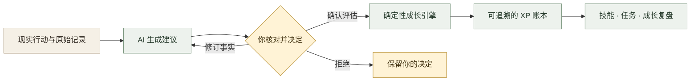

<div align="center">

# 🌱 AI Personal Growth RPG

### 把现实中的积累，变成看得见、可追溯的成长。

学习笔记 · 真实作品 · 技能树 · 成长复盘

**一个在本机使用、由 AI 辅助整理、由你确认成长的个人 RPG。**

[](https://github.com/Daylily-Huang/AI-Personal-Growth-RPG/actions/workflows/ci.yml)    

[项目理念](#项目理念) · [核心功能](#核心功能) · [开始使用](#开始使用) · [本地资料](#本地资料) · [开发进展](#开发进展) · [开发文档](#开发文档)

---

**记录真实行动　→　留下可查证据　→　看清成长轨迹　→　决定下一步**

</div>

> **当前状态 · 2026-10-17**
>
> 核心成长闭环与主要本机功能已交付，支持 **PPTX / DOCX 本地文字读取**，本轮新增 **图片本机文字识别与核对预览**。网站和数据库在本机运行；按你的配置，AI 可以使用云端服务。已完成能力与后续计划在下方分别列出。

## 项目理念

一篇笔记、一份汇报、一个脚本、一次复盘，往往分散在不同文件夹里。这个项目希望把这些真实积累串起来：**你做过什么，留下了什么材料，哪些能力有了进展，接下来还缺哪一步。**

RPG 是呈现成长的方式。活动、任务、技能、作品与里程碑围绕现实行动组织；经验值有确定的计算规则，能力判断需要相应证据，AI 的建议始终可以核对、修改或拒绝。

适合用于学习与技能训练、研究与项目推进、作品积累，以及长期个人复盘。

<table>
  <tr>
    <td width="33%" valign="top"><strong>📝 从行动出发</strong><br><br>保留原始记录，整理活动与材料，让每次积累都有出处。</td>
    <td width="33%" valign="top"><strong>🌿 让能力有脉络</strong><br><br>通过技能树、知识图谱和任务关系，看到长期发展的方向。</td>
    <td width="33%" valign="top"><strong>🧭 用复盘找下一步</strong><br><br>把日、周、月的客观记录与 AI 分析结合起来，形成可执行的调整。</td>
  </tr>
</table>

## 核心功能

| | 模块 | 已实现的能力 |
| :---: | --- | --- |
| 🎮 | **成长仪表盘** | 查看成长状态，接收入账、升级反馈；提供新用户指引和动效开关 |
| 📝 | **活动与 AI 建议** | 记录原始输入、评估活动、修订事实后重新评估；支持修改、拒绝与确认 |
| 🌳 | **技能树** | 手动建立零 XP 技能，查看技能关系与成长；区分经验和掌握度 |
| 🕸️ | **知识图谱** | 建立与浏览知识关系，支持移动端列表和键盘操作 |
| 🎯 | **任务系统** | 主支线与层级任务、进度聚合；可输入正数百分比增量，支持小数，上限 100% |
| 📎 | **证据与原文** | 查看活动原始详情、提交材料；保留 E0 / 未验证状态与独立验证边界 |
| 🗂️ | **作品与里程碑** | 作品库、关系链接、手动验收、现实里程碑、愿望积分与心愿流程 |
| 📊 | **成长复盘** | 日 / 周 / 月复盘、完整上月对照；客观摘要和 AI 分析分别呈现 |
| 📁 | **本地资料** | 连接指定文件夹，读取笔记、代码、PPTX、DOCX，识别图片文字；AI 整理建议，由你确认后记录 |

### 一次成长记录如何完成



本地资料整理是另一个入口：**确认保存资料建议，只会创建活动与 E0 未验证证据**；需要经验结算时，继续进入既有活动评估与确认流程。

### 始终坚持的成长规则

| 原则 | 在产品中的含义 |
| --- | --- |
| **时间不是 XP** | 花了多久不能直接证明获得了多少成长 |
| **XP 不是掌握度** | 经验积累与能力水平分别记录 |
| **高掌握度需要证据** | 自述、材料提交、手动验收与独立验证保持不同状态 |
| **AI 提建议，你作决定** | AI 不直接写入永久成长结果 |
| **计算和账本可追溯** | 最终 XP 由确定性代码计算，每笔变更都有账本记录 |
| **尊重真实学习过程** | 重复活动会衰减奖励；失败也可能产生 Learning XP |

## 开始使用

### 已经安装了本机版本

使用原有桌面入口打开网站，登录后可以从以下三条路径开始：

1. **记录一次活动**：写下做了什么、完成程度和结果，核对 AI 评估后决定是否确认。
2. **整理已有资料**：打开 **产出台 → 本地资料**，连接笔记或作品文件夹，勾选资料生成建议。
3. **查看成长复盘**：进入日 / 周 / 月复盘，对照客观记录与 AI 分析，安排下一步。

升级后若页面仍显示旧内容，先刷新网页，再刷新文件清单。浏览器可能会再次请求文件夹读取授权。

### 在新开发环境中运行

需要 **Node.js 22、pnpm 11.7.0**，以及用于本机 Supabase 的 Docker。版本与仓库 CI 配置对齐。

**1 · 获取代码和依赖**

```bash
git clone https://github.com/Daylily-Huang/AI-Personal-Growth-RPG.git
cd AI-Personal-Growth-RPG
pnpm install --frozen-lockfile
```

**2 · 准备本机数据库**

在 Docker 已运行的全新开发环境中启动本机 Supabase：

```bash
pnpm exec supabase start
```

此命令用于初始化或启动当前项目的本机服务。已有个人数据的环境沿用现有启动方式；升级数据库需先备份并核对迁移，勿用 `db reset` 代替升级。

**3 · 配置环境变量**

复制 [`.env.example`](.env.example) 为未跟踪的 `.env.local`，填入本机 Supabase 返回的 URL 和公开客户端密钥；需要真实 AI 时再配置模型服务。变量含义以本节和当前源码为准，示例文件中的早期阶段注释是历史说明。

```dotenv
# 本机 Supabase：值来自你自己的本机服务
NEXT_PUBLIC_SUPABASE_URL=http://127.0.0.1:54321
NEXT_PUBLIC_SUPABASE_PUBLISHABLE_KEY=your_local_publishable_key

# OpenAI 兼容的 AI 服务：填写自己的地址、模型和密钥
AI_BASE_URL=https://your-ai-provider.example/v1
AI_MODEL=your_model_name
AI_API_KEY=your_private_api_key
```

也支持对应的 `OPENAI_BASE_URL`、`OPENAI_MODEL`、`OPENAI_API_KEY`；`AI_*` 同名配置优先。`SUPABASE_SECRET_KEY` 仅供需要它的服务端管理场景使用，不能加上 `NEXT_PUBLIC_` 前缀。

**4 · 启动与登录**

```bash
pnpm dev
```

打开 `http://127.0.0.1:3000/login`，注册或登录本机账号。生产构建可使用：

```bash
pnpm build
pnpm start
```

开发与生产启动脚本默认均只监听 `127.0.0.1`。现有桌面安装可能使用单独端口，以自己的桌面入口为准。

<details>
<summary><strong>关于 Demo、未配置 AI 和本机启动器</strong></summary>

- 仓库保留了本地 JSON 与确定性模拟 AI 的开发路径；它们不能代替真实登录、真实评估或正式验收。
- 登录页面需要配置 Supabase。开发体验账号入口还需显式开启 `NEXT_PUBLIC_ENABLE_DEV_DEMO_ACCOUNT=true`，生产环境不会启用。
- 本地资料 API 要求真实登录和本机数据库，不会降级到 Demo；未配置 AI 时不会编造资料整理建议。
- 现有 Windows 桌面入口属于本机安装配置，不能假定全新 clone 会自动带上它。它会核验已接受版本、构建、配置与服务归属，升级时应保持这些绑定一致。

</details>

## 本地资料

### 从文件夹到活动建议

**连接文件夹 → 查看清单 → 勾选文件 → 同意 AI 处理 → 核对建议 → 确认记录**

扫描只读取文件清单，不调用 AI。点击“交给 AI 整理建议”后，在浏览器本地读取或提取所选文件文字，再发送给当前已配置的 AI。你可以修改活动与证据文字，核对原文摘录和不确定点，也可以拒绝建议。

图片可先点击“本机识别所选图片”，使用Windows自带OCR在本机内存中处理；原图片不发送云端、不保存到服务器文件。对照图片编辑识别文字，再单独同意AI处理文字。OCR可能漏字或混淆数字、单位，不能直接作为已验证事实。

图片使用顺序：**勾选图片 → 本机识别所选图片 → 对照原图修改文字 → 同意AI处理 → 交给AI整理建议 → 核对并确认记录**。支持混合选择图片、Office文档与文本，总份数和字数上限共同计算。

### 支持的文件

| 文件类型 | 读取内容 | 单文件上限 |
| --- | --- | --- |
| **PNG / JPG / JPEG / WebP / BMP** | 本机Windows文字识别；预览并编辑后只发送文字给AI | 10 MiB |
| **PPTX** | 按实际播放顺序提取幻灯片文字与演讲备注，保留页序标记 | 20 MiB |
| **DOCX** | 正文段落、表格中的文字 | 20 MiB |
| **Markdown / TXT** | UTF-8 文本，含 `.md`、`.mdx`、`.txt` | 128,000 字节 |
| **代码与文本数据** | R、Python、JS/TS/JSX/TSX、JSON、CSV、HTML、CSS、TeX、Notebook 文本 | 128,000 字节 |

**每次最多 8 份文件，提取文字合计最多 64,000 字符。** 超限、加密、损坏或没有可提取文字会报错，整批不会发送，不自动截断。

<details>
<summary><strong>读取范围、连接方式与重复确认</strong></summary>

- 桌面 Chrome / Edge 支持记住文件夹连接、重新授权、手动刷新和断开。其他浏览器可使用一次性目录选择；本地文档解压还需浏览器支持相应 API。
- 每次最多扫描 200 个可用文件、2,000 个项目、8 层子目录。隐藏目录、依赖目录和明显的密钥文件会跳过，仍需自行取消勾选敏感资料。
- 不在后台监听文件变化，不扫描整台电脑，不修改原文件。
- 支持独立静态图片中的印刷文字；本机Windows需有可用OCR语言。较大图片最长边缩至2,600像素，原图上限4,000万像素；请求栅格上限6MiB。动态图片、手写和复杂图表不保证识别准确率。
- 暂不解析 PDF、旧版 PPT / DOC、SVG、GIF及Office嵌入图片；没有文字、损坏或超限会明确报错，不自动调用云端图片服务。
- 识别预览仅留当前页面内存，断开或刷新连接会清除。修改文字会撤销AI同意；原图变化后必须重新识别。
- DOCX 页眉、页脚、脚注和批注，以及 PPT 图表 / SmartArt 的独立数据部件暂不读取。文字提取不等于完整重现文档的视觉内容。
- 同一相对名称与同一提取文字版本重复确认，会返回原活动。来源哈希绑定实际发送的文字，不能作为原文件二进制完整性证明。
- 活动和证据分两步保存。证据失败时活动可能已存在，页面保留原请求便于安全补交；创建结果不明时，应先检查活动历史，系统不会自动重建。
- 未保存的 AI 建议有效 1 小时；服务重启后需重新分析。断开会移除记住的目录，进一步撤销权限可在浏览器站点设置中操作。

</details>

## 数据与 AI 的边界

| 内容 | 处理方式 |
| --- | --- |
| **原始笔记、PPT、Word、代码文件** | 保留在电脑，连接只读；原文件与嵌入媒体不上传公开网站或 GitHub |
| **所选文件的必要文字** | 在明确勾选并同意后，交给当前 AI 服务；云端模型会接收到这部分文字 |
| **确认后的活动、材料与成长账本** | 保存到本机数据库；私有数据通过认证和 RLS 隔离 |
| **模型密钥与数据库管理密钥** | 仅在服务端使用，不进入浏览器或仓库 |
| **GitHub 仓库** | 托管代码、产品文档与测试，不用来存放个人学习资料和数据库 |

> **本机运行与 AI 离线是两回事。** 当前方案允许云端 AI 处理经你同意的必要文本；网站本身保持本机使用，未部署公网，也未开放手机局域网访问。

## 技术架构

| 层次 | 主要技术与职责 |
| --- | --- |
| **界面** | Next.js 16 App Router · React 19 · TypeScript · Tailwind CSS 4 |
| **关系可视化** | React Flow：技能与知识关系浏览 |
| **应用与成长规则** | 服务端 API、严格数据校验、确定性 Growth Engine、可追溯账本 |
| **AI** | OpenAI 兼容接口，生成结构化建议；原始事实、模型判断和用户确认分开 |
| **本机数据** | Supabase / PostgreSQL · Auth · RLS · 事务 RPC |
| **验证** | Vitest · 数据库集成 · HTTP 流程验证 · 真实浏览器检查 |

<details>
<summary><strong>仓库结构</strong></summary>

```text
src/
├── app/                 页面与服务端 API
├── components/          界面组件
└── lib/                 业务逻辑、数据访问与规则
    ├── growth-engine/   确定性成长计算
    ├── ai/              AI 配置与评估契约
    ├── local-library/   本地资料、文档文字提取与确认回执
    └── supabase/        本机数据服务与认证连接
supabase/                数据库配置与迁移
tests/                   规则、权限、数据和交互回归
docs/                    产品规范、阶段验收与交接记录
```

</details>

## 开发进展

**本轮新增：独立图片本机文字识别、对照预览与核对后AI整理。**

**此前已验功能基线：[PR #67](https://github.com/Daylily-Huang/AI-Personal-Growth-RPG/pull/67) · `951a634a` · 2026-10-17**

| 进展 | 交付内容 |
| --- | --- |
| [#67](https://github.com/Daylily-Huang/AI-Personal-Growth-RPG/pull/67) | PPTX / DOCX 浏览器本地文字提取，文档错误与上限处理 |
| [#66](https://github.com/Daylily-Huang/AI-Personal-Growth-RPG/pull/66) | 指定文件夹连接、AI 活动与证据建议、确认与来源去重 |
| [#65](https://github.com/Daylily-Huang/AI-Personal-Growth-RPG/pull/65) | 自定义任务进度增量，支持小数和 100% 上限 |
| [#64](https://github.com/Daylily-Huang/AI-Personal-Growth-RPG/pull/64) | 动效增强、持久开关与减少动态效果支持 |
| [#63](https://github.com/Daylily-Huang/AI-Personal-Growth-RPG/pull/63) | 月度复盘、上月对照与成长反馈 |
| [#62](https://github.com/Daylily-Huang/AI-Personal-Growth-RPG/pull/62) | 私有日 / 周复盘 |
| [#61](https://github.com/Daylily-Huang/AI-Personal-Growth-RPG/pull/61) | 作品手动验收与首次愿望积分 |
| [#60](https://github.com/Daylily-Huang/AI-Personal-Growth-RPG/pull/60) | 事实修订与 AI 重新评估 |
| [#59](https://github.com/Daylily-Huang/AI-Personal-Growth-RPG/pull/59) | 活动材料提交与未验证证据边界 |

完整历史见 [CHANGELOG](CHANGELOG.md)。

### 后续候选

- [ ] PDF、旧版 Office 与更多文档内容解析
- [ ] Office内嵌图片与更完整的文档内容支持
- [ ] PWA 与手机局域网访问
- [ ] 更多外部服务集成

以上属于后续候选，尚未交付；公网发布也不属于当前本机使用范围。

## 质量验证

PR #67 的自身及合并后 CI 均通过：**169 个测试文件、4,860 项数据库完整测试、0 跳过**；另有确定性成长引擎 Harness 11 项、核心 HTTP / E2E 11 项通过。该数字绑定这次功能基线，后续结果查看 [GitHub Actions](https://github.com/Daylily-Huang/AI-Personal-Growth-RPG/actions)。

[查看 PR 检查](https://github.com/Daylily-Huang/AI-Personal-Growth-RPG/actions/runs/38931582224) · [查看合并后检查](https://github.com/Daylily-Huang/AI-Personal-Growth-RPG/actions/runs/38932835167)

```bash
pnpm test
pnpm harness:deterministic
pnpm lint
pnpm build
```

数据库集成使用隔离测试栈与 `XP_RPG_TEST_DB_URL`，不要将测试指向个人正式数据库。缺少数据库时部分用例会跳过，不能据此宣称完整通过。CI 的 `supabase-integration` 执行真实数据库、认证、RLS、事务与核心 HTTP 流程验证。

Office 功能还通过了标准虚构文档的真实 Chrome 检查：正文、表格、备注、来源哈希、明确同意、损坏文件阻止发送与 390px 布局。该轮浏览器的 AI / 认证接口使用合成拦截，没有调用真实云端 AI 或写入正式数据；系统原生文件夹选择器 UI 未自动化。验证范围详见下方文档。

图片功能另通过真实Windows OCR及Chrome浏览器：PNG/JPG/WebP/BMP、文字修改撤销同意、原图变化阻止发送、空白识别失败、刷新与断开清除预览、390px布局；虚构笔记经现有真实AI生成建议，隔离账号确认前0写入、确认后1活动/1份E0未验证材料/0 XP。原生系统文件夹选择器未自动化，正式个人账号未参与。

## 开发文档

| 文档 | 内容 |
| --- | --- |
| [系统与产品规范](docs/Design%20ChatGPT/README_SPEC_PACK.md) | 世界观、成长规则、产品设计、架构、AI 契约与质量规范 |
| [项目交接](docs/MASTER_PROJECT_HANDOFF.md) | 当前本机状态、架构、治理要求与历史记录 |
| [本地资料流程](docs/SiteReadiness/26_LOCAL_FOLDER_LIBRARY.md) | 文件夹连接、AI 建议、确认与安全边界 |
| [图片本机OCR](docs/SiteReadiness/28_LOCAL_IMAGE_OCR.md) | 图片格式、本机识别、可编辑预览与隐私边界 |
| [PPTX / DOCX 读取](docs/SiteReadiness/27_LOCAL_OFFICE_TEXT_IMPORT.md) | 文档提取范围、限制与验收记录 |
| [开发记录](CHANGELOG.md) | 最近功能变更与规则影响 |
| [编码约束](AGENTS.md) | 贡献代码前需要遵循的项目规则 |

<div align="center">

---

**让成长有记录，让能力有证据，让下一步有方向。**

</div>
